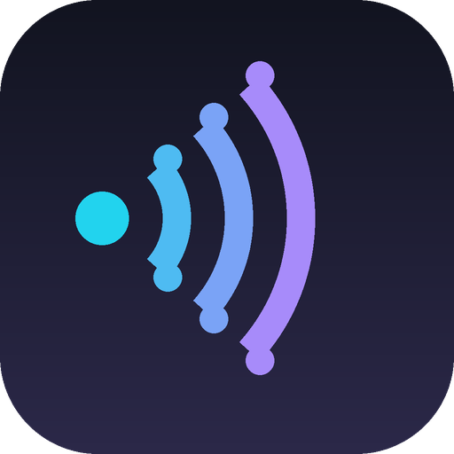

<p align="center">
  
</p>

<h1 align="center">NooXMeteer</h1>

<p align="center">
  <b>Play your PC's sound on every speaker and headphone at the same time.</b><br>
  A simple, dark, modern Windows app. No cables, no virtual drivers, no setup headaches.
</p>

<p align="center">
  
  
  
</p>

<!-- Add a screenshot here:
<p align="center"></p>
-->

---

## Why NooXMeteer?

Windows normally sends sound to **one** output device at a time. If you want music on your desk speakers *and* your headphones (or a TV, a Bluetooth speaker, a second room), you usually need virtual audio cables and a lot of patience.

NooXMeteer makes it a one-click job: pick the devices you want, press **START**, and you're done.

## Features

- 🔊 **Multi-output audio**: send system sound to any number of speakers and headphones at once
- 🎚️ **Per-device volume**: every extra device has its own slider
- 🧪 **Test button**: play a short beep on any device to check it works
- 🎤 **Microphone selector**: use the system default or pick one manually, with a live level meter and a mute button
- 🌙 **Dark, modern UI** that anyone can use without reading a manual
- 🔔 **System tray support**: closing the window keeps the app running in the background
- 💾 **Remembers your choices**: selected devices, volumes and microphone are saved
- 🪶 **Lightweight**: no drivers, no background services, no system changes

## How it works

NooXMeteer captures the Windows system audio (WASAPI loopback, provided by Electron) and routes a copy of it to every device you enable, using the Web Audio API with per-device output selection.

```
Windows system audio ──► NooXMeteer ──┬──► Speakers
                                      ├──► Headphones
                                      └──► Any other output device
```

> **Note:** your current Windows default output device always plays the sound natively, so it is shown as *"System default · always on"* and cannot be toggled. Every other device is controlled from NooXMeteer. This also prevents audio feedback loops.

## Installation

### Option 1: Installer

Download the latest `NooXMeteer Setup x.x.x.exe` from the **Releases** page and run it.

### Option 2: Build it yourself

**Requirements:** [Node.js](https://nodejs.org) (LTS) on Windows.

```bash
git clone https://github.com/<your-username>/NooXMeteer.git
cd NooXMeteer
```

Then either double-click **`build-setup.bat`**, which installs dependencies and builds the installer into the `dist/` folder, or run the steps manually:

```bash
npm install
npm start          # run in development
npm run dist       # build the Windows installer
```

## Usage

1. Open NooXMeteer.
2. Turn on the devices you want in **Output Devices**.
3. Adjust each device's volume if needed.
4. Press **START** and play anything on your PC.
5. Close the window to send the app to the system tray. Right-click the tray icon and choose **Exit** to quit completely.

Use the **Test** button next to a device to confirm it can play sound.

## Troubleshooting

| Problem | What to check |
| --- | --- |
| A device is enabled but silent | In Windows **Sound settings → More sound settings → Playback → Properties → Levels**, make sure the device is **not muted** and its volume is not zero. |
| Test beep works, music does not | Make sure something is playing; the *Captured system audio* bar should move. |
| Bluetooth sound turns mono and low quality when the microphone is used | This is a classic Bluetooth limitation (Hands-Free profile) and cannot be fixed by software. Use a separate microphone, or disable the headset's "Hands-Free" devices in Windows sound settings. |
| Echo between speakers in the same room | Extra devices have a small delay (roughly 50–150 ms). Bluetooth devices add their own latency. |
| Debugging | Press **F12** to open the developer console. |

## Known limitations

- Windows only.
- The Windows default output device cannot be switched off from inside the app.
- Secondary devices have a small amount of latency compared to the default device.
- The microphone selector controls the in-app meter and mute only; it does not change the Windows default microphone.

## Roadmap

- [ ] Start with Windows
- [ ] Auto-start distribution on launch
- [ ] Per-device delay compensation
- [ ] Change the Windows default microphone from the app

## Tech stack

- [Electron](https://www.electronjs.org/)
- Web Audio API (`AudioContext.setSinkId`)
- Plain HTML, CSS and JavaScript (no frameworks)
- [electron-builder](https://www.electron.build/) (NSIS installer)

## Project structure

```
NooXMeteer/
├── main.js           # Electron main process, loopback capture, tray
├── index.html        # UI
├── renderer.js       # Audio routing and UI logic
├── style.css         # Dark theme
├── icon.png / .ico   # App icons
├── build-setup.bat   # One-click installer builder
└── package.json
```

## Contributing

Issues and pull requests are welcome. If you report a bug, please include your Windows version, the output devices you used (wired, USB, Bluetooth) and any message shown under the START button.

## License

MIT. See the `LICENSE` file, or replace this section with the license of your choice.

---

<p align="center">Made with ♥ by <b>NooX</b></p>
